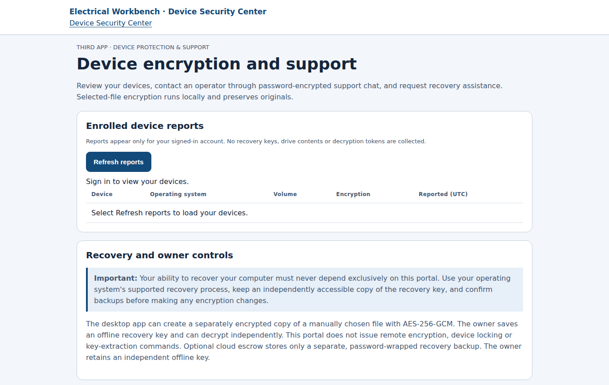
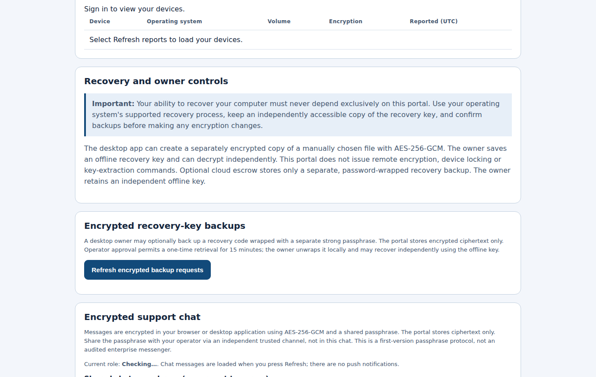
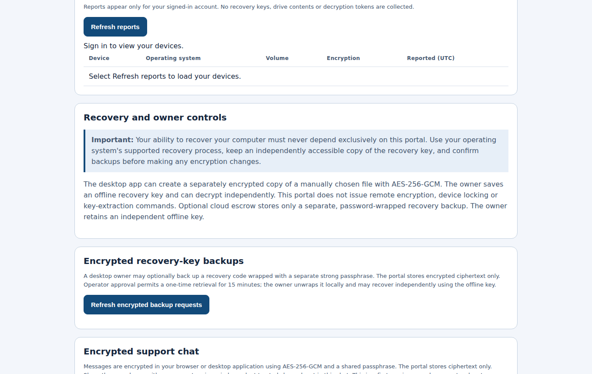

# 🛡️ GHOST PROTOCOL

**An experimental Windows desktop and companion cloud portal for user-controlled file-copy encryption, independent offline recovery, device-status reporting, and encrypted owner–operator support.**

GHOST PROTOCOL is a separate JavaFX application with a Spring Boot web portal. It was extracted from [Electrical Workbench](https://github.com/GFH-GhostsFromHell/electrical-workbench) into its **own repository**, retaining its desktop, API, web interface, tests and build workflows.

[**Windows builds**](https://github.com/GFH-GhostsFromHell/device-security-center/actions/workflows/build-ghost-protocol-desktop.yml) · [**Portal build**](https://github.com/GFH-GhostsFromHell/device-security-center/actions/workflows/build-device-security-portal.yml) · [**Source code**](https://github.com/GFH-GhostsFromHell/device-security-center) · [**Security and recovery notes**](ghost-protocol-desktop/README.md)

> [!WARNING]
> **Prototype, not production-ready security software.** This project's cryptography, authentication, recovery workflows and deployment controls have **not been independently audited**. Test with disposable sample files only. The app **preserves the original unencrypted file**; creating an encrypted copy does *not* secure the original. Do not rely on this app as your only backup or for important personal or business data.

## See the interface

These screenshots are generated from the **actual HTML and styles checked into this repository**. The page is served locally without a production account or backend; images show interface structure and empty states, **not real customer records or a verified live deployment**. The [screenshot workflow](.github/workflows/capture-readme-screenshots.yml) regenerates them when the page changes.

| Device overview and status reporting | Encrypted recovery-key backup and review |
|:--:|:--:|
|  |  |



*Windows JavaFX desktop screenshots have not yet been captured; the images above are web UI screenshots only.*

## What GHOST PROTOCOL does

| Capability | How it works |
| --- | --- |
| **Windows device status** | Runs a **read-only** local BitLocker status check; no encryption settings or drive keys are modified. |
| **Voluntary cloud reporting** | With consent, submits a device alias, operating system, volume, encryption status and report time to the owner's account. |
| **Selected-file protection** | The owner manually selects **one file** and creates a separately encrypted `.zts` copy using **AES-256-GCM**. The original file remains untouched. |
| **Offline recovery** | Generates a fresh recovery code for the file copy. The owner must save and confirm it independently. A matching code is needed to restore the protected copy. |
| **Optional cloud recovery backup** | A separately chosen passphrase wraps the recovery code *locally* using PBKDF2-HMAC-SHA256 and AES-256-GCM. The portal stores ciphertext, not plaintext keys or passphrases. |
| **Operator-approved release** | An authenticated owner requests retrieval of their own encrypted backup. An operator can approve or deny it. Approval permits **one ciphertext retrieval within 15 minutes**; the owner unwraps it locally. |
| **Encrypted support chat** | The Windows client and web interface exchange passphrase-encrypted support messages. Participants must share a strong chat passphrase through another trusted channel. |
| **Review trail** | Owner/operator support and escrow requests have explicit states and audit-related records. |

### Four desktop sections

The Windows app has four tabs: **Device status**, **Encrypt file**, **Cloud recovery**, and **Support chat**. The browser portal includes device reports, owner recovery controls, encrypted backup requests, operator approvals, encrypted support messages and recovery-review requests.

**Designed boundaries:** no full-disk encryption, operating-system/boot-file changes, recursive file processing, deletion of originals, forced encryption, remote device locks or background encryption commands.

## Platform and availability

| Component | Stack | Availability |
| --- | --- | --- |
| **Windows desktop** | Java 21 + JavaFX | [Download the MSI or portable ZIP from a successful GitHub Actions run](https://github.com/GFH-GhostsFromHell/device-security-center/actions/workflows/build-ghost-protocol-desktop.yml). Builds include a bundled Java runtime and are **unsigned**. |
| **Web portal** | HTML/CSS/JavaScript + Spring Boot | Standalone source lives in [`portal/`](portal/). Run locally as described below. **No separate public GHOST PROTOCOL deployment is established by this repository.** |
| **Backend and persistence** | Spring Security, JDBC/JPA, local H2 or PostgreSQL | Separate owner/operator accounts from environment variables; local developer persistence is file-backed H2. |

**The default desktop cloud address currently points to the legacy hosted Electrical Workbench portal.** To connect to a standalone GHOST PROTOCOL server, explicitly set `PORTAL_URL`. A successfully built portal is not proof of a publicly deployed or audited service.

## How file-copy recovery works

```text
  Windows desktop                         Owner's independent backup
  ┌──────────────────────┐                ┌──────────────────────────┐
  │ Choose ONE test file │                │ Save offline recovery    │
  │ Create encrypted copy├── key saved ──►│ code outside this PC     │
  │ Original preserved   │                └──────────────────────────┘
  └──────────┬───────────┘
             │ Optional separate passphrase wraps offline code locally
             ▼
  ┌────────────────────────────────────────────────────────────────┐
  │ Spring Boot cloud portal + database                            │
  │ Stores wrapped ciphertext; does not receive plaintext key      │
  │ Owner requests release → Operator approves/denies              │
  └───────────────────────────┬────────────────────────────────────┘
                              │ Single-use ciphertext retrieval
                              ▼
                      Owner unwraps locally
                      with separate passphrase
                              │
                              ▼
                     Restore encrypted copy
```

**Recovery never has to depend on a portal operator.** If the independently saved offline recovery code is available, the owner can restore the encrypted copy without cloud access.

## Quick start for developers

**Requirements:** JDK 21 and Maven. Windows is needed for local BitLocker status inspection and Windows MSI packaging. The JavaFX UI can be built and tested through Maven. Use a local sandbox environment and non-critical test files.

### 1. Clone and test

```bash
git clone https://github.com/GFH-GhostsFromHell/device-security-center.git
cd device-security-center

mvn -B -f ghost-protocol-desktop/pom.xml test
mvn -B -f portal/pom.xml test
```

### 2. Configure and run the local portal

Set **four different account values**, with separate strong owner/operator passwords of at least 12 characters. Do not reuse production passwords or commit credentials.

```powershell
$env:ZT_OPERATOR_USERNAME = "operator"
$env:ZT_OPERATOR_PASSWORD = "<unique password, at least 12 characters>"
$env:DEVICE_OWNER_USERNAME = "owner"
$env:DEVICE_OWNER_PASSWORD = "<different password, at least 12 characters>"
mvn -B -f portal/pom.xml spring-boot:run
```

Open `http://localhost:8080/device-security.html` and sign in with one of the configured accounts. The local service uses file-backed H2 by default. For a custom PostgreSQL database, set `SPRING_DATASOURCE_URL`, `SPRING_DATASOURCE_USERNAME` and `SPRING_DATASOURCE_PASSWORD`.

### 3. Start the desktop against the local portal

In a **second PowerShell terminal**, run:

```powershell
$env:PORTAL_URL = "http://localhost:8080"
mvn -B -f ghost-protocol-desktop/pom.xml javafx:run
```

If `PORTAL_URL` is unset, the desktop uses the original cloud portal's URL, **not** your local instance. Only localhost HTTP is accepted; use HTTPS for remote connections.

### 4. Try the safe workflow

1. Choose a **disposable test file** under **Encrypt file**.
2. Save the displayed offline recovery code independently, then re-enter it to confirm it was recorded.
3. Create the `.zts` copy and verify you can restore it with the offline code.
4. If desired, test an optional encrypted cloud backup using a **different escrow passphrase** and your own local portal.
5. Use the owner account to request a release; use the operator account to review it.
6. For chat, share a separate strong passphrase by an independent trusted channel, then use **Support chat**.

Do not put recovery codes or chat passphrases in support messages, GitHub issues, screenshots or logs.

## CI, installers and validation

| Workflow | Purpose |
| --- | --- |
| [Build GHOST PROTOCOL (Windows)](.github/workflows/build-ghost-protocol-desktop.yml) | Runs Java tests, packages a bundled-runtime Windows application, produces `DeviceSecurityCenter-Windows-Installer.msi` and `DeviceSecurityCenter-Windows-Portable.zip`, and uploads build artifacts. |
| [Build GHOST PROTOCOL Portal](.github/workflows/build-device-security-portal.yml) | Runs Maven verification for the standalone Spring Boot portal. |
| [Validate Device Security Web UI](.github/workflows/validate-device-security-web.yml) | Checks browser JavaScript syntax and presence of important portal UI controls. |
| [Capture README Screenshots](.github/workflows/capture-readme-screenshots.yml) | Captures the checked-in web interface using an isolated, empty local preview. |

To download an installer, open a **successful** Windows workflow run, scroll to **Artifacts**, and download the installer or portable package. Artifacts have a retention period; an artifact is not a signed or independently verified release.

## Repository structure

```text
ghost-protocol-desktop/
  src/main/java/com/gfh/devicesecurity/   JavaFX UI, file-copy crypto, recovery and chat
  src/test/                                Desktop crypto and device-status tests
  pom.xml                                  JavaFX Maven build
portal/
  src/main/java/com/example/remoteportal/ Standalone Spring Boot entry point
  src/main/java/.../device/               Device, escrow and support endpoints
  src/main/resources/static/              GHOST PROTOCOL browser UI
  src/test/                                Cloud endpoint tests
  pom.xml                                  Spring Boot Maven build
docs/screenshots/                          Source-code web screenshots (generated by CI)
scripts/                                   Screenshot generation helper
.github/workflows/                         Windows, portal, JS and screenshot jobs
```

## Technical details and security limitations

- Encrypted copies use **AES-256-GCM** with a randomly generated per-file key and authenticated ciphertext. A failed authentication must not produce a valid restored file.
- **64 MiB maximum per selected file** in this prototype. Large-file streaming/chunked encryption is not supported.
- Cloud recovery wrapping and support-chat passphrase derivation use **PBKDF2-HMAC-SHA256 (210,000 iterations)** with AES-GCM. This is not an audited enterprise key-management or secure-messaging protocol.
- No forward secrecy, independent chat identity verification or automated secure passphrase exchange is provided.
- The separately saved recovery code and separate escrow passphrase are critical. Losing them can make recovery impossible. The server's operator does **not** possess the owner's plaintext file key.
- Cloud storage should be protected by TLS, hardened account management, appropriate CSRF and rate-limit controls, backups, logging review and a professional security assessment **before public production use**.
- The code is intentionally **not ransomware** and does not implement unattended mass encryption, full-system locking, remote enforcement, deletion or tampering with original files.

For deeper protocol notes, consult the [desktop README](ghost-protocol-desktop/README.md) and [standalone cloud notes](portal/README.md).

## Project background, license and contributions

This repository was extracted from the [Electrical Workbench](https://github.com/GFH-GhostsFromHell/electrical-workbench) codebase to separate GHOST PROTOCOL development from electrical field tools. The original repository was not overwritten by the extraction.

This codebase is **publicly visible**, but no open-source license is currently included. Public visibility alone does not grant rights to reuse or redistribute it. Contributions and bug reports can be discussed in [GitHub Issues](https://github.com/GFH-GhostsFromHell/device-security-center/issues) without posting real data, secrets or recovery material.
